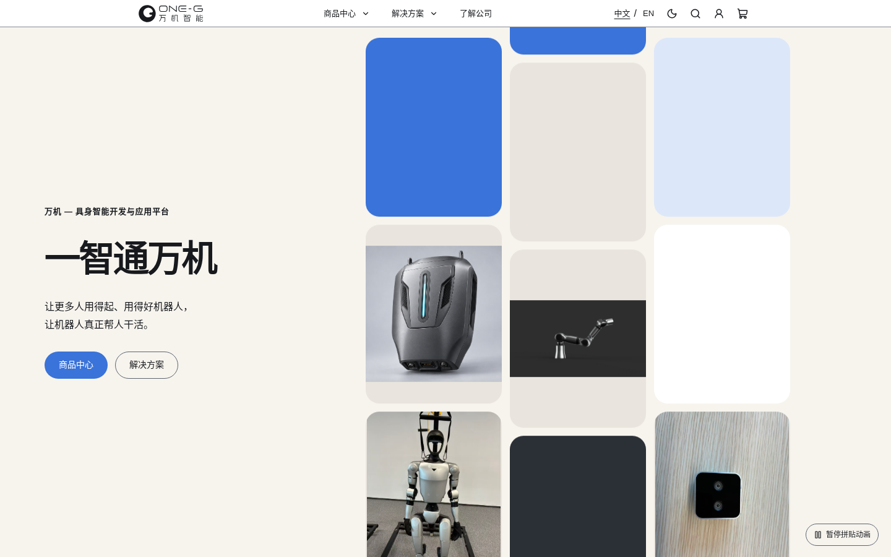

# ONE-G / 万机智能

**一智通万机**

**公司定位：具身智能开发与应用平台。**

愿景：让更多人用得起、用得好机器人，让机器人真正帮人干活。

ONE-G 希望把模型、软件和硬件接起来，让客户不必每次从头开发。本仓库是围绕这一定位建设的**品牌官网、产品与解决方案展示及选购流程前端原型**，用于验证内容组织、交互和业务边界；它不是已完成的机器人控制系统、模型平台或生产电商系统。

## 项目概览

- 基于 Next.js App Router、React 与 TypeScript，由 `create-next-app` 初始化并持续扩展。
- 当前采用静态导出，仓库配置 GitHub Actions 发布 `out/` 到 GitHub Pages。
- **RoboDock 是商品**，当前为首代产品构想与套餐预览，尚未开放销售。
- **SONIC Link 是遥操作解决方案**，不作为商品出售或加入购物车。
- 本地商品、方案与测试数据驱动界面；未接入正式认证、订单、支付、邮件或数据库服务。

## 当前功能

| 模块 | 当前实现 | 边界 |
| --- | --- | --- |
| 首页 | 品牌拼贴 Hero，商品与方案 Layout Grid 点击展开预览 | 内容展示，不操作机器人 |
| 导航与搜索 | 全量图片导航、菜单分类筛选、缩略图到网格过渡、本地栏目/商品搜索 | 非远程全文搜索 |
| 商品中心 | 分类筛选、GSAP Flip、统一商品网格、详情与技术信息 | 多数商品为 Mock；部分图片/型号待确认 |
| RoboDock | 概念图、安装草图、来源支持的接入/算力规划与技术说明、四种现有套餐 | 价格待确认，购买页加购禁用 |
| 解决方案 | 四类方案；SONIC Link 详情与 6 段按需播放的实机/仿真研究视频 | 逐项展示能力边界，非已交付自动化案例 |
| 登录与账户 | 手机/邮箱登录界面、安全返回、角色守卫、用户与管理员页面 | 显式本地 Mock；生产认证尚未接入 |
| 购物车与订单 | 用户隔离的本地演示流程、支付方式预选、演示订单 | 不创建真实订单、不收款 |
| 公司与咨询 | ScrollExpand、愿景/定位、互动吊牌、深度定制说明、需求校验与预览 | 不发送邮件或需求到后台 |
| 语言与外观 | 中文/英文、light/dark、圆形主题切换、偏好保存 | 仅两种外观；无多主题面板 |

现有普通卡片统一提供精确鼠标悬停反馈：整卡上移 4px、200ms 柔和阴影；触屏不启用，减少动画时不位移。商品筛选和首页展开期间停用悬停，保留原有布局及选中样式。见 [卡片交互说明](docs/CARD_HOVER.md)。

2026-10-21 素材与说明整合：四个只读来源的固定提交、媒体哈希、授权确认、文案证据、未确认项及验收见 [媒体来源清单](docs/media-sources.md)。研究视频不等于已交付功能；RoboDock 暂定规格保留规划限定。

详细的 **18 个模块**、页面和代码位置见 [功能说明](docs/FEATURES.md) 与 [开发状态](docs/PROJECT_STATUS.md)。

全局网页字体采用本地托管的 Inter Variable 与 Noto Sans SC（SIL OFL 1.1），系统字体仅作回退。来源、版本、完整许可、实际 Rendered Fonts 与体积变化见 [字体审计](docs/font-audit.md) 和 [第三方声明](THIRD_PARTY_NOTICES.md)。

## 技术栈

以下版本依据当前 `package-lock.json`，不是全部采用 `package.json` 的版本范围。

| 类别 | 实际技术 |
| --- | --- |
| 框架 | Next.js 16.3.4，App Router，静态导出 |
| UI / 类型 | React / React DOM 19.2.8，TypeScript 5.9.3 |
| 样式 | Tailwind CSS 4.3.3、PostCSS、CSS Modules、普通 CSS、颜色 Token |
| UI 基础 | Lucide React、Radix Slot、clsx、tailwind-merge；局部适配的 Magic UI / Aceternity 组件 |
| 动画 | GSAP 3.15.0 / Flip、Motion 13.4.0、CSS keyframes、原生 Web Animations / View Transitions |
| 品牌吊牌 | Three.js、React Three Fiber / Drei、React Three Rapier、meshline |
| 状态 / 偏好 | React Hooks / Context、URL 参数、浏览器存储、next-themes 0.4.6 |
| 质量与部署 | ESLint 9、TypeScript、Node 内置测试及可选浏览器脚本；GitHub Actions / Pages |

认证与订单适配器是本地 Mock 或未配置的服务接口；仓库没有真实数据库/认证 SDK/支付网关接入。`ogl` 等历史效果依赖仍在依赖清单中，不代表旧首屏正在使用。

## 系统架构

```text
浏览器操作 → React 页面/组件 → lib 适配器 → data 本地商品/方案数据
                     ├→ Context / URL / 浏览器存储（交互和偏好）
                     └→ 认证/订单接口：本地 Mock 或“未接入”回退
GitHub Actions → Next.js 静态构建 → out/ → GitHub Pages
```

正式后台、数据库和外部业务 API 尚未接入。前端角色守卫和浏览器订单记录不能作为生产授权、成交或付款凭据。详见 [架构说明](docs/ARCHITECTURE.md)。

## 项目目录

```text
.
├── src/
│   ├── app/                 # 路由页面、根布局、全局样式和配色
│   ├── components/          # 共享 UI、业务组件、Context Providers 与局部效果
│   │   └── ui/              # Layout Grid、主题切换、品牌按钮等
│   ├── data/                # 商品、方案、导航及历史配置/演示数据
│   ├── lib/                 # 商品查询、权限、购物车、订单/认证适配器与工具
│   ├── i18n/                # 词典、语言 Context、展示文本本地化
│   └── types/               # 商品、方案、用户、购物车和配置类型
├── public/                  # Logo、商品图、方案媒体与吊牌资源
├── tests/                   # 单元/浏览器验收脚本，含历史测试
├── docs/                    # 当前说明、历史设计和审计记录
├── .github/workflows/       # GitHub Pages 自动部署
├── next.config.ts           # 静态导出、/one-g 部署前缀
└── package-lock.json        # npm 锁文件
```

## 安装与启动

Node.js **20.9.0 或以上**、npm；当前 CI 使用 Node.js 20。在仓库根目录执行：

```bash
npm ci
npm run dev
```

打开 **http://localhost:3000/one-g/**。端口被占用时，以终端实际输出为准。修改 `src/app/page.tsx` 等源码可触发开发热更新。

```bash
npm run lint
npx tsc --noEmit
npm run build
```

没有单独的 `typecheck` 或 `test` npm script；不要使用不存在的命令。可选 Mock 开关、测试与故障排查见 [开发说明](docs/DEVELOPMENT.md)。

## 构建与部署

`npm run build` 生成 `out/`，无需运行 Next.js 服务器。配置为 `output: "export"`、`basePath: "/one-g"`、`assetPrefix: "/one-g/"`、尾斜杠及未优化图片。

[deploy-pages.yml](.github/workflows/deploy-pages.yml) 在推送 `main` 或手动触发后安装依赖、构建并上传 `out/` 到 Pages。GitHub 仓库需将 Pages 来源设置为 GitHub Actions。本说明记录工作流配置，**不表示本次已推送、发布或确认线上版本**。

保留 `/one-g/` 的本地静态预览方法及资源路径规则见 [部署说明](docs/DEPLOYMENT.md)。`npm run start` 虽然存在，但 `next start` 不适用于当前静态导出部署方式；没有证据表明项目部署在 Vercel。

## 项目截图

以下为当前本地静态导出的真实页面截图（1440 × 900），没有使用旧主题或旧版界面截图。



[商品中心](docs/images/products.png) · [解决方案](docs/images/solutions.png) · [了解公司](docs/images/about.png)

[截图来源与更新说明](docs/images/README.md)

## 当前开发状态

网站展示与交互已实现；需要外部服务的业务当前仍是前端演示或未接入。状态统一使用“已实现 / 前端演示 / 开发中 / 计划中”，不以百分比表达进度。

- **已实现**：品牌内容、导航、网格展开、商品筛选、页面展示、中英文与日夜偏好。
- **前端演示**：购买套餐、验证码登录、用户/管理员中心、购物车/订单、需求预览。
- **计划中**：生产认证、持久化数据、服务端报价和订单、真实支付、邮件发送、后台管理与地址管理。
- 没有足够代码证据把一个尚未接入的后端模块标记为“开发中”。

## 已知限制

- 生产构建禁用 Mock 登录和 Mock 订单；不能在公开静态站点使用演示身份完成真实交易。
- RoboDock 是概念产品，部分规格、设备型号、适配和交付信息仍待确认；其它商品存在 Mock 价格和占位媒体。
- SONIC Link 的说明与演示媒体不等于本仓库提供遥操运行环境或机器人设备驱动。
- 浏览器存储仅适用于演示与偏好，不能跨设备同步或作为服务端安全边界。
- 新商品 slug 需要重新构建；纯静态 Pages 不能直接运行认证/支付后端或接收回调。
- WebGL、View Transitions、浏览器存储可用性会影响局部体验，相关组件提供不同程度的回退。
- 历史文档、旧截图和残留效果文件不代表当前入口仍启用。没有完整项目 LICENSE，品牌、图片和组件来源需分别核对。

## 开发计划

以下是根据当前缺口整理的后续方向，不是已实现能力或交付承诺：

1. 核实商品型号、真实媒体、价格、技术规格与交付状态。
2. 设计并接入正式认证、数据库、服务端权限与订单接口。
3. 在服务端完成定价、库存和幂等控制，再接入支付网关及通知核验。
4. 接入需求提交/邮件服务、地址管理与真实后台 CRUD。
5. 持续完善语言、可访问性、浏览器兼容与当前入口回归测试。

## 相关文档

- [系统架构](docs/ARCHITECTURE.md)
- [功能说明](docs/FEATURES.md)
- [开发指南](docs/DEVELOPMENT.md)
- [构建与部署](docs/DEPLOYMENT.md)
- [项目状态与未完成项](docs/PROJECT_STATUS.md)
- [截图说明](docs/images/README.md)

`docs/` 还保留历史规划/审计，查阅时请注意日期和与当前代码的差异；本组说明以当前代码为准。

页面主要操作通过 `effect="invert"` 显式使用 200ms 的主题反色反馈，保留原尺寸、禁用/焦点状态与业务行为；导航、小按钮、分类与 Tab 保持原样。旧按钮 WebGL/Canvas 与调度器已移除，不影响其它页面动画。见 [按钮交互说明与验收](docs/BUTTON_EFFECTS.md)。

顶部主栏目点击直接跳转，悬停预览与移动端展开分开处理；组合交互与性能检查见 [导航专项报告](docs/reviews/NAVIGATION_INTERACTION_AUDIT.md)。
