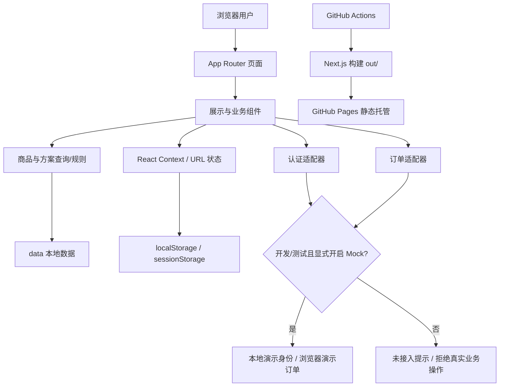

# 系统架构

[项目首页](../README.md) · [功能](FEATURES.md) · [开发](DEVELOPMENT.md) · [状态](PROJECT_STATUS.md)

## 范围与运行方式

这是 Next.js App Router 网站，页面在构建时导出 HTML、JS、CSS 和静态资源。React 在浏览器接管交互；构建使用服务器组件不等于部署了业务服务器。当前没有 `src/app/api/`、数据库模型/迁移或对接真实业务服务的 HTTP 请求流程。

公司“具身智能开发与应用平台”是品牌定位；本站展示机器人商品和方案，不负责下发机器人控制命令、训练模型或管理实际设备。

## 页面壳与状态来源

`src/app/layout.tsx` 中根级 `ThemeProvider → LocaleProvider → AuthProvider → SiteShell` 提供统一状态。`SiteShell` 内 `ContactProvider` 管理需求预览。管理员页面有独立展示壳，登录页和公开页面使用共享 Header。

| 状态 | 代码 | 来源/持久化 |
| --- | --- | --- |
| 当前用户与初始化 | `components/AuthProvider.tsx`、`lib/auth-client.ts` | Mock 身份映射、受环境保护的演示会话；不是服务器 session |
| 语言 | `i18n/LocaleProvider.tsx`、`dictionary.ts` | 中文 SSR 默认、挂载后恢复本地偏好；更新正文而非整页重挂 |
| 外观 | `components/ThemeProvider.tsx`、`ThemeToggle.tsx` | 单一 next-themes；light/dark；`one-g-appearance-v1` |
| 首页展开 | `HomePreviewProvider.tsx` | 一个带区域前缀的 selectedId，两组 Layout Grid 协调 |
| 商品筛选 | `app/products/page.tsx` | URL category 参数与 GSAP Flip 布局状态 |
| 套餐与数量 | `ProductPurchase.tsx` | 本地组件状态及 URL package/quantity 参数 |
| 支付方式 | `lib/payments.ts`、`usePaymentPreference.ts` | URL 与用户 localStorage/访客 sessionStorage；不发起付款 |
| 客服需求 | `ContactProvider.tsx`、`lib/contact-preview.ts` | 已登录用户的前端填写、校验、预览；没有发送端点 |

没有 Redux、Zustand 或全局业务数据库。剩余 `lib/configuration/` 和旧 schema 是历史兼容/迁移代码，不代表旧配置工作台仍启用。

## 商品与解决方案

- `data/products.ts` 与 `data/products/robotdock.ts` 是商品数据来源，`lib/products.ts` 统一查询，`types/product.ts` 定义形状。
- `data/solutions.ts` 是四个方案的数据来源，SONIC Link 长内容在 `data/solutions/sonic-link.ts`。方案可引用商品 ID，但不因此成为商品。
- 首页只保存展示 ID 列表；通过现有数据派生标题、状态和链接，不维护第二份商品数据库。
- `lib/product-policy.ts` 判断展示状态和加购许可。RoboDock 为 concept，购买页只允许套餐预览。Mock active 商品也不代表真实销售/库存已核实。
- `public/` 保存公开媒体；Next Link 根据 basePath 处理页面路由，现有图片字段通常已经含 `/one-g/`，不能再次拼接。

## 认证与角色边界

`lib/demo-mode.ts` 要求 development/test 环境及显式 Mock 开关；正式构建始终关闭。普通入口是手机号/邮箱验证码界面。本地开发快捷登录仅使用虚构白名单，统一入口可返回演示 USER/ADMIN；验证码挑战服务本身是内存 Mock，不发送短信或邮件。

`RequireRole`、`auth-routing.ts` 和 `safeReturnTo` 在前端控制访问和安全返回。它们改善演示流程，不能代替生产后端授权。旧 `/admin/login` 只进入统一登录流程；旧 `/register`、`/forgot-password` 是兼容说明，不执行注册或密码重置。

## 购物车、订单与支付

`lib/cart.ts` 按演示用户隔离本地购物车。`lib/commerce/service.ts` 定义服务契约：Mock 启用时仅创建 DEMO 前缀、pending 状态的本地订单并校验幂等输入；未启用时拒绝创建。没有成功收款、订单持久化数据库或真实银行收款资料。浏览器记录即使被修改，也不能作为 paid 结果。

`PaymentSelector` 只选择支付宝、微信支付或对公转账。`initiatePayment` 当前明确返回渠道未接入/资料待配置，不调用支付网关。`order-success` 查询演示订单，不能依据 URL success 参数认定付款成功。

## 兼容入口

`LegacyConfigurationRedirect`、`LegacySonicLinkRedirect` 与首页旧锚点映射保留旧链接访问能力。`/configure`、`/customize` 等进入当前商品/购买内容；旧 SONIC Link 商品、购买和规格入口进入遥操作方案。它们是客户端兼容导航，不是新功能，也不是 Pages 服务器 301 配置。

## 普通卡片悬停与动画边界

共享规则在 `components/card-hover.css`，由根布局加载；`CardHover.tsx` 只提供稳定的外层命中区域。普通卡片显式使用 `data-card-hover-host` / `data-card-hover-surface`，不会根据 div/article 或模糊类名自动匹配。CSS individual translate 和 box-shadow 完成 200ms/-4px 反馈，不添加依赖、鼠标位置状态或每帧事件。

商品中心保留外层 Product ID、Grid 身份与 Flip transform，完整视觉表面位于内层；已有 `data-filter-animating` / inert 标记即时停用新增位移。首页 slot 感知 hover，独立包装层承载悬停，Motion article/img 保持原 layoutId 和布局动画。展开前设置局部停用标记，回位完成事件解除；减少动画关闭路径直接复位，两个 Grid 选择状态仍由原 Provider 协调。

选中套餐的内阴影通过局部 `--card-rest-shadow` 与新增阴影叠加。只有 hover:hover、pointer:fine 设备启用位移；减少动画取消新增位移和过渡。日夜只改变新增阴影，沿用原主题颜色和状态。范围与实际验收见 [卡片交互说明](CARD_HOVER.md)。

## 后续服务接入

认证、商品/订单数据库、服务端报价、支付通知、需求提交和管理员 CRUD 均是待完成项。现有 TypeScript service 接口为后续接入提供边界，但目前没有真实服务接入证据。[历史后台规划](backend-plan.md) 与 [历史数据库规划](database-plan.md) 仅供设计参考，不列作当前技术栈。
