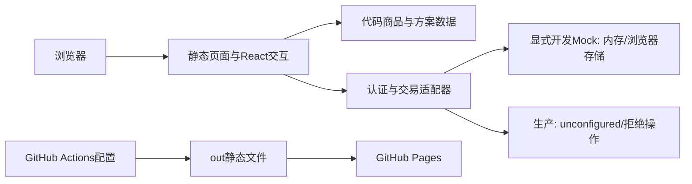

# ONE / ONE-G 前后端只读审查与实施规划

更新：2026-10-30。沿用 2026-10-29 同用途主报告，扩展为全栈审查，不另造平行报告。历史证据保留于 `review-evidence/2026-10-29/`，本轮证据在 [2026-10-30-fullstack](review-evidence/2026-10-30-fullstack/)。本报告描述当前工作树，不代表远端已经部署、服务已经接入或安全已经全面认证。

## 1. 执行摘要

**当前产品是可浏览的品牌官网和选购流程前端原型，尚不能完成真实注册、咨询提交、下单或收款。** 公开展示、商品/方案分离、图片导航、主题与语言切换已有可复用实现；身份、挑战、购物车和订单仅有开发 Mock，生产模式明确拒绝这些演示能力。管理员页面是只读功能预览，不是可信后台。

本轮没有证据支持全站重设计、重做 Provider、换动画体系或增加视觉效果。前端最值得投入的是：

1. 让商品/咨询入口在点击前准确表达当前可完成范围，避免用户在加购后才遇到不可用登录。
2. 对齐购物车和订单的数量约束，补持久化失败反馈与恢复；本轮已用页面复现 1000 件购物车到结算被拒，以及存储失败无界面提示。
3. 审核商品规格、价格和媒体身份，统一首页/目录/详情对同一 ID 的表达；不要用新图或新文案假装补齐产品事实。

后端最需要补的是：可信账户/会话及逐请求授权；持久化咨询与可追踪通知；服务端报价/订单快照/幂等及经验证的付款状态。它们是**待接入项**，不能通过打开 Mock 开关完成。

**建议首个真实闭环：已验证邮箱账户 → 提交咨询 → 获取记录编号 → 本人查询 → 管理员受权查看 → 通知失败可重试。** RoboDock 尚无确认售价，G1 资料也不足，先做咨询比先收款更符合当前业务事实。第一批只做该路径所需的用户、会话、挑战、咨询与审计，不要求一次建完所有候选表。

lint、类型检查、11 个现有测试文件中的 49 项测试、生产构建通过。关键本地浏览器分项三次复验通过；异常注入复现了真实问题。不能据此声称全部 E2E、真实服务或全部浏览器通过。没有确认的 P0；没有把未接入服务描述为已被利用的生产漏洞。

## 2. 对象、Skill、环境与保护基线

| 项目 | 本轮事实 |
| --- | --- |
| 根目录、分支、提交 | `/home/lsh/ONE`，`main`，`8fc2cf82e86b11d912bd99a68580877258779acc` |
| 工作树优先级 | 使用当前磁盘内容；未拉取远端、未切分支、未覆盖本地工作树 |
| 已暂存 | 无；没有冲突项 |
| 未暂存源码 | `src/app/products/products.module.css`，唯一差异是文件末尾换行被去掉；原样保留 |
| 开始时未跟踪 | `docs/ONE_PROJECT_REVIEW.md` 与 `docs/review-evidence/`，均为已有审计产物；不视作本轮新发现的业务实现 |
| 适用规则 | 实际读取项目根 `AGENTS.md`；上级 `/home/lsh`、`/home`、`/` 未找到 AGENTS.md。项目内未发现更深层适用规则 |
| Oil UI Pro | 实际读取 `/home/lsh/.agents/skills/oil-ui-pro/SKILL.md`，name=`oil-ui-pro`，0.27.1；使用 task-review、existing-project、workdir、visual-review、ux-review、review-loop、tools；未调用免费版 |
| VibeHub | 实际读取 `/home/lsh/.codex/skills/vibehub/SKILL.md`，name=`vibehub`；解析器 revision `8bd0124c23d96f32`；未修改 Skill |
| Skill 范围 | 一轮只读独立视觉评审、一轮独立 UX 开放探索及其自主风险探针；不打分，不修正/改版。版本更新检查会超出限定写入范围，未执行、未重装或付费 |
| 工具环境 | Node 24.20.0、npm 11.19.0、Python 3.10；已有 Chromium 153（playwright chromium-1243）；没有可解析的 playwright-core 包，未安装依赖；ffmpeg 不可用 |
| 副本 | `/tmp/one-fullstack-review/runtime`；按748个跟踪文件从当前工作树复制必需代码，公共资源与 node_modules 只读复用；不复制 `.env` 或凭据，测试结果写隔离目录 |
| 本机运行 | 3011 为显式开发 Mock；3012 为本轮 `out/` 的静态生产预览，均仅绑定127.0.0.1；不代表线上状态 |
| 保护 | 开始记录748个跟踪文件SHA-256；最终核对见 [integrity.json](review-evidence/2026-10-30-fullstack/integrity.json)。构建和类型缓存均留在副本 |

没有改源码、package.json、锁文件、数据库、部署配置、AGENTS、README 或设计规范，没有提交/推送。浏览器仅临时独立会话、虚构资料和本地故障注入；截图中的演示码已遮盖。独立执行标识为 `/root/independent_ux`、`/root/independent_visual`，证据有各自报告与真实画面。

## 3. 实际技术栈与结构

Next.js 16.3.4 App Router、React 19.2.8、TypeScript strict；Tailwind 4 与 CSS Modules/全局语义色并用。数据来自 `src/data`，策略/选择器在 `src/lib`，展示和交互在 `src/components`。本地 Inter / Noto Sans SC 及来源/许可证保留。

根 `ThemeProvider → LocaleProvider → AuthProvider → SiteShell`，Contact 在 SiteShell 内；HomePreviewProvider 协调首页两组 Layout Grid。主题/语言不是通过全站 key 重建页面；用户隔离页面随用户ID切换是刻意边界。按钮复用 Elements/LocalizedLink/ProtectedLink 与用途/反色样式；ProductCard 共享商品展示。**无独立 SolutionCard**，方案卡由 SolutionExplorer 负责展开、媒体和业务说明，不需要强行与商品卡合成万能组件。

GSAP Flip 负责商品筛选/图片菜单，Motion 负责首页卡片展开，WAAPI/CSS 负责局部入场/悬停，原生 View Transitions 负责主题。About 保留独立 Three/WebGL 吊牌。当前按钮没有启用旧 Specular Canvas：`invert-actions` 测试及源码入口检查均支持这一点；历史说明里曾出现的旧调度器不代表仍挂载。OGL/TechText/MicroSlats 等保留文件也不能仅按存在就判定运行泄漏。

实际部署配置为 `output: "export"`、`trailingSlash: true`、`basePath: "/one-g"`、`assetPrefix: "/one-g/"`、图片不走动态优化。GitHub Actions 用 Node20、`npm ci`、build、上传 out、Pages deploy。**构建时有 Server Components 不等于部署了业务服务。** 已读所装 Next 的 static-exports 文档并与配置/构建输出核对，没有改框架版本。

图中未画数据库、网关、邮件和支付服务为已部署节点。

## 4. 真实能力清单：实现状态与验证状态分开

“部分实现”可包含真实本地前端能力；“真实接入”仅指确实有外部服务证据，本轮业务服务无此项。每行运行验证仅限所述行为。

| 能力 | 实现状态 | 当前验证状态及边界 |
| --- | --- | --- |
| 首页、商品/方案/公司展示 | 部分实现（本地真实前端） | 运行验证：1440/390，首页、目录、G1、RoboDock、SONIC代表页；不是全部路由矩阵 |
| 导航、图片菜单、分类、搜索、basePath | 部分实现 | 当前导航专项与分类探针见证据；safeReturnTo/前缀/角色单元测试通过；不把历史全部通过陈述算本轮测试 |
| 旧SONIC购买/详情/configure入口 | 部分实现（兼容） | 三条旧入口三次真实跳到遥操作方案；其他旧参数组合仅源码/现有单元测试覆盖 |
| 注册/密码/验证码登录 | Mock；正式尚未接入 | 49项中的认证测试运行通过；注册空表/dirty/确认离开、语言主题保留运行；本轮未完整重跑所有浏览器开户步骤 |
| 人机、邮件验证码、手机号绑定、微信 | 人机/邮箱挑战Mock；真实发件、绑定和微信尚未接入 | 用途/目标/地区/期限/尝试/一次性在Mock测试通过；供应商服务未验证 |
| 实名 | 尚未接入 | 源码无证件输入、明确未开通；不采集证件、不产生实名成功状态 |
| 会话查询/退出/角色 | Mock | 本地存userId、生产伪造管理员会话被拒3次；无可信Cookie会话、服务端过期/撤销机制 |
| 商品与套餐 | 部分实现：审核前的代码数据 | canonical selector、9商品、RoboDock四套餐预览；没有真实商品API/库存/权威价格 |
| 报价、购物车 | 购物车Mock；服务端报价尚未接入 | 本地加购/数量/读回/错误注入；数量边界问题见FS02，读写无法代表服务器持久化 |
| 订单 | Mock | 本地DEMO pending、同键重试同单、拒绝SONIC/未知价格及伪造paid运行；无数据库订单项快照 |
| 支付/回调/对公核对 | 尚未接入；回调处理不存在于本仓库 | initiatePayment明确拒绝，银行信息null；没有真实收款、通知或到账核验测试 |
| 咨询与邮件通知 | 部分实现：仅本地填写/校验/预览；正式提交尚未接入 | 源码确认不会发送，UX生产登录门槛复现；无记录查询/发件结果 |
| 管理员模块/接口 | 页面预览；CRUD尚未接入 | admin/page 明确只读占位；生产不能用Mock身份进入；无远端管理API可评估 |
| Route Handlers/Server Actions/独立后端 | 本仓库不存在业务入口 | 枚举路由、源码调用、依赖和部署共同确认，非根据单一文件名推断；无已配置外部HTTP业务适配器 |
| DB连接/模型/迁移/备份恢复 | 本仓库不存在实现 | backend-plan/database-plan是规划文档；没有可验证远端DB，不推断不可见系统是否另有保护 |
| 媒体、字体 | 部分实现：静态本地分发 | 现有字体/媒体49项测试内的来源哈希检查通过，代表页无破图；未重新核验外部版权或全视频播放 |
| CI/部署 | 部分实现：静态发布配置存在 | 本轮build通过；线上Actions/域名/安全响应头、实际部署版本尚未验证 |

## 5. 前端诊断与五项细节

首页、商品、方案各有独立职责；RoboDock stable ID/slug仍为 `robotdock`，显示名称为 RoboDock；SONIC Link 在 solutions/teleoperation，历史商品入口兼容跳转，不能重新放进购物车。

ProductCard props（product/hidden/flipId）分别承担内容、可见性和动画身份，没有明显需要另建统一巨型卡片的证据。首页以ID和选择器取内容，但 Vision V1 仍有编辑性封面回退，跨入口媒体状态需审核；方案 content 借用 Product 的部分文案结构只是类型耦合，暂无混售复现。

代表页1440/390测量无横向页面溢出/已完成图片失败；英文夜间注册补采中长按钮、输入与错误可读。字段级错误有 aria-invalid/describedby，验证码保留字符串及一次性码输入语义。自动检查发现RoboDock辅助文案12px；这不是自动判WCAG失败，但关键停售说明应在阅读尺寸下保证可读，下一次局部调整再验证。不据小字自动重做所有卡片。

注册保护仅dirty时安装，空表可直接离开；取消离开保留输入，确认清理，语言/主题不触发离开提示。本轮相关分项连续3次通过；历史取消刷新R01仍未在完整注册回归/真机上解决，不能写为已修复。密码帮助与错误逐字重复确实仍存在。

| 五项细节 | 当前源码与本轮结论 | 冲突/未验证 |
| --- | --- | --- |
| 1 数值稳定 | AuthFields ResendLabel使用tabular-nums及aria-hidden预留状态；价格/数量局部使用；验证码保留字符串 | 未运行全倒计时边界浏览器矩阵，不宣布所有秒数宽度稳定 |
| 2 同心圆角 | ProductCard桌面24px外圆角、20px链接、12px padding；手机12/8/8局部值 | 没有统一派生机制，仍不能称专项完整实施；并非已证实交互错误，不建议全站统一圆角 |
| 3 渐次入场 | StaggerGroup 独立宿主，IntersectionObserver/WAAPI/减少动画及清理 | Hero/Grid/Flip排除；仅源码确认全生命周期，未做长时间资源采样 |
| 4 标题平衡 | ProductCard等局部text-wrap:balance，产品CSS本地差异仅末尾换行 | 未做全部字体缩放矩阵；保留品牌硬断行和逐行揭示 |
| 5 多层阴影 | card-hover.css显式data-card-depth、hover宿主与内表面分层；reduced/forced-colors回退 | 商品分类与首页展开沿用各自transform，未见需要合并动画体系的证据 |

性能边界：HomeCollageHero用IntersectionObserver和visibilitychange暂停，并清理动画；Header timers/Flip/RAF/resize有清理；Lanyard有可见性暂停和geometry/material/texture/renderer dispose。EvidenceVideos使用preload=none，播放第二个暂停第一个，但源码未实现离屏/后台主动暂停。由于用户可主动播放带声音视频，本轮不把“离屏仍可能播放”直接判为性能缺陷；需单独确认播放策略并测量后再改。未做长时间内存、GPU/CPU、帧率或核心Web指标测量。

独立视觉报告：[visual-review.md](review-evidence/2026-10-30-fullstack/visual-review.md)；独立开放UX：[ux/report.md](review-evidence/2026-10-30-fullstack/ux/report.md)。保留品牌、拼贴、两组Grid、当前字体和导航结构。Pro工具“缺少滚动叙事”提示与用户约束不符，不转为新增动效建议；品牌眉标有定位意义，保留。

## 6. 问题与接入缺口（含位置、复现、根因及验收）

P1表示对相应真实业务上线的阻塞；不代表已证实存在可被攻击的线上漏洞。P2为当前行为/一致性或维护问题；P3为低影响建议。每项明确证据强度。

### FS01 — P1 前端/接口：公开选购、咨询到未开放登录处中断【尚未接入】

位置：`src/components/AddToCartButton.tsx:30`、`src/components/ContactProvider.tsx:52`、`src/lib/demo-mode.ts:2`。
复现：生产静态G1 → 加入购物车 → 登录暂未开放；购物车/咨询亦依赖身份。证据：focused-browser-checks三个run、UX 07/08/09截图。影响：标价和可点击动作形成保存/成交期待，后半程无法继续。
确定根因：销售展示策略没有结合服务可用状态；正式adapter unconfigured。待核实：业务本阶段希望接受何种有效线索。最小建议：入口准确表达预览/未开放边界，连接真实咨询服务后再提供可完成出口；不把Mock开启到生产。
依赖：业务确认公开能力和首个真实闭环。验收：中英文访客点击前能理解范围；每个主动作最终有可查询结果或准确的不可用说明，不显示假成功。

### FS02 — P2 前端/接口：购物车数量与订单上限冲突【实际缺陷，新确认】

位置：`src/app/cart/page.tsx:41`（updateQuantity及无max输入）、`src/lib/cart.ts:40`（累计数量）、`src/lib/commerce/service.ts:41`。
复现：Mock购物车数量填1000，持久化成功，结算选择支付后建单被拒；或先加999再加1。证据：[supplement-browser-checks.json](review-evidence/2026-10-30-fullstack/supplement-browser-checks.json)、cart-1000/checkout-quantity-error截图；[module-probes.json](review-evidence/2026-10-30-fullstack/module-probes.json)连续3次相同。
影响：用户到结算才发现无法下单。确定根因：加购仅检查增量，购物车编辑/parseCart无同一上限，订单另限999。待核实：正式SKU数量上限应否不同。
最小建议：用一处数量策略同时检查编辑、累计、合并和下单；拒绝越界时保留原数量并就地解释。依赖：产品确认数量规则。验收：0/1/999/1000、999+1、旧超限记录、非法数、重新编辑均有一致结果；服务器未来仍独立校验，不能只加HTML max。

### FS03 — P2 前端：购物车存储失败缺少恢复反馈【实际缺陷，新确认】

位置：`src/app/cart/page.tsx:33`初始化Promise无catch，`:40`写入/移除同步handler；`src/lib/cart.ts:33`。
复现：独立会话只让cart键setItem抛出合成存储异常，再改数量；出现Uncaught Error，界面没有role=alert反馈，旧记录保留。证据：supplement-browser-checks中ui-cart-storage-failure；原始探针异常源自明确注入，不是自发线上报错。
影响：受限存储、容量用尽或未来请求失败时用户无法理解保存状态。确定根因：Cart页面写入路径没有catch/status；读取JSON失败也被当空数据处理。待核实：具体真实浏览器限制条件的发生率。
最小建议：成功后更新UI；失败保留可编辑值和旧已保存值，显示错误与重试，不伪报已保存；加载失败与空车分开。依赖：若本地adapter即将替换可在新adapter实施同一契约。验收：注入读/写失败、恢复存储重试、刷新读回、跨用户切换，无未处理异常/静默丢失。

### FS04 — P1 后端/接口：可信身份、会话及授权未接入【上线阻塞；当前为Mock】

位置：`src/lib/auth-client.ts:13`、`auth/accounts.ts:44`、`auth/account-service.ts:13`、`auth/human.ts`、`auth/verification.ts`、`components/RequireRole.tsx`。
证据：调用与部署矩阵、49项测试、生产伪造会话拒绝。注册固定USER并拒绝role；旧shortcut只认已存在fixture，不是自动开户。邮箱被验证、手机号仅填写且phoneVerified=false；海外邮箱规则在policy及adapter重复执行，不只是隐藏按钮；地区由用户选择，不跟随语言。bind-phone只是类型候选，checkedContext不开放该用途。
影响：没有真实账户持久性、服务器挑战、会话过期/撤销及逐请求对象授权；前端PBKDF2/内存限流不构成正式信任。确定根因：这就是演示adapter。未知：没有可见外部后端，不能判定某个不可见服务有漏洞。
最小建议：可信服务处理密码/挑战/会话，普通注册固定USER，管理凭据独立保护；订单/咨询/购物车每次按会话用户查归属，不接受body里的userId/role决定权限。依赖：部署方案、身份/发件供应商及数据政策。
验收：并发重复注册唯一账号；login码不能register/bind；未验证手机号不能登录；伪role被拒；过期/退出/撤销后请求失败；两个用户交叉ID访问均拒绝；正式构建Mock开关仍无效。属于待实现验收，不写成已通过。

### FS05 — P1 后端/数据/支付：缺少可信报价、持久订单与付款核对【真实交易上线阻塞】

位置：`src/types/product.ts:9`、`lib/commerce/service.ts:8`、`:44`、`:54`、`app/checkout/page.tsx:47`、`app/order-success/page.tsx:22`。
证据：金额由浏览器canonical数据计算，未采纳客户端传入total，但仍非服务器；Order.items仅ID/数量，没有名称/单价/套餐/税费版本快照；状态enum将订单/支付阶段混在一起。initiatePayment始终拒绝，bankDetails为null，无回调入口。重复键同输入本地返回同单，修改paid记录被过滤，成功页忽略URL success。
影响：现有模型不能作真实销售账本、对账或履约依据。确定根因：本地pending演示；不是已发生篡改收款。未知：未来税费、运费、套餐销售规则尚未定义。
最小建议：服务器按ID/套餐/数量重算并存快照，整数最小货币单位和显式币种；订单状态、支付状态、履约状态分离；数据库唯一幂等键+请求摘要。支付尝试独立记录，回调验签、核对商户/金额/币种/订单及状态，事件去重和合法状态迁移同事务；乱序不得倒退或重复履约。对公展示银行资料不能等同到账，须受权人工/可信银行记录核实并审计，用户上传凭据只能置待核实。
依赖：审核销售数据、持久数据库、支付渠道/回调环境；本轮不选供应商或收款。验收：篡改客户端金额不起作用；并发重试只建一单；同键异请求冲突；重复/乱序通知不重复履约；URL success不能改paid；不匹配通知不入账；银行凭据不自动确认。

### FS06 — P1 后端/接口/数据：咨询没有正式记录与通知【真实咨询上线阻塞】

位置：`components/ContactProvider.tsx:102`、`:107`、`lib/contact-preview.ts:17`。
证据：submit仅校验并setPreview，文案明确“尚未提交”，没有HTTP路径、数据库写入或邮件；管理员模块也不读取咨询。影响：目前无法收集、跟进真实需求。确定根因：明确的前端预览。没有证据显示已提交需求因邮件失败丢失。
最小建议：先在事务中保存咨询和待通知任务/状态，返回编号；本人查询和管理员查询分别授权。邮件失败仍保留记录，重试不重复建咨询；通知重试可先用同服务内持久任务表/定时任务，不上消息平台。回复邮箱是联系资料，不能自动绑定登录标识。
依赖：FS04及最小持久存储、管理端权限、字段长度/保留期。验收：重复提交同编号；无归属用户不能查询；通知失败能看到记录和失败状态；重试不重复记录；无服务时继续准确显示预览而非已发送。

### FS07 — P2 前端/数据：商品事实与媒体成熟度不一致【部分实现/设计建议】

位置：`components/HomeProductsPreview.tsx:13`、`data/products.ts`、`components/ProductCard.tsx:18`、`app/products/[id]/page.tsx:33`、`types/solution.ts`。
证据：Vision首页编辑性实拍/目录字标；G1有价格和加购但核心参数仅型号/类别。独立视觉见首页RoboDock与巡检图默认卡只标名称，展开后才有概念/边界；方案归类没有混售。影响：型号识别及选型决策依据不足。
确定根因：资料待审核，首页fallback与canonical媒体状态不同；不是照片对应型号已被证实错误。最小建议：每ID保存审核状态、素材角色/来源、适用展示位置；统一媒体状态表达；无规格不编造，无价格仍取quote-required。RoboDock“购买”入口/标题可改成准确套餐预览文义，属于建议不是混售漏洞。
依赖：产品/媒体审核人。验收：首页/菜单/目录/详情同ID名称、概念身份与销售资格一致；RoboDock未售仍禁购；SONIC仍为解决方案。商品内容此阶段仍可留审核后的代码文件，不必先建CMS。

### FS08 — P2 部署/测试：发布门槛及既有测试基线不完整【维护风险】

位置：`.github/workflows/deploy-pages.yml:31`、`tests/header-image-navigation.browser.cjs:2`、`tests/button-effects.browser.cjs:37`及`docs/reviews/invert-buttons/baseline.json`。
证据：CI只有安装/build/deploy；旧导航测试仍要求两个button及已不存在的更多设置；按钮快照仍存Arial而当前为Inter/Noto；本轮缺playwright-core，原E2E未执行，不把旧失败计为本轮运行结果。
影响：构建通过不能守住交互和业务边界，旧断言易误导修产品。确定根因：测试维护未完整跟随当前契约；实际线上CI是否另有组织门槛未验证。
最小建议：迁移断言为真实Link/菜单图片边界，复核字体和几何后更新快照；为选定安全测试提供可复现浏览器工具路径，再加lint/types/关键测试门槛。依赖：确认当前基线和CI执行环境。验收：本地与CI命令一致，异步关键测试连续3次通过，不能靠删业务断言通过；发布失败可回滚原静态产物。

### FS09 — P3 前端：注册密码规则重复【实际缺陷】

位置：`RegistrationForm.tsx:76`、`auth/accounts.ts:20`。空表触发验证，help和error相同；本轮中英截图与DOM再次确认。影响：重复阅读、窄屏冗余及辅助技术重复关联。
根因：常驻帮助和错误共用同句，不是密码策略错误。最小建议：错误态只展示/关联一次规则，保留错误定位、aria-invalid和明确说明。依赖无。验收：正常、错误、中英文/夜间手机均只朗读一次，验证条件不变。

### FS10 — P3 前端：有效160 CSS px导航溢出【实际缺陷，支持范围待确认】

位置：`HeaderBrand.module.css:68`附近actions不收缩。三次CSS160模拟测得scrollWidth/header252。旧报告另有物理320×原生200%证据；本轮没有把CSS160模拟宣称原生缩放复验。影响：极窄窗口工具溢出。根因：最小工具宽度超过可用宽。建议先确认最小支持宽，再局部重排；不缩字号、不全页overflow:hidden。验收：分别记录物理宽、CSS宽、zoom及工具可达；普通390基线不变。

### FS11 — P3 前端：从详情返回丢分类【可复现体验问题，非安全缺陷】

位置：`app/products/[id]/page.tsx`返回商品中心Link及`ProductCard.tsx:14`详情href。机器人分类→G1→页面返回入口→全部；独立UX 10/11/12截图。影响：同类比较要重选。确定根因：返回href固定/products，未携带来源上下文；是否必须保留滚动尚待产品确认。
建议：仅携带经验证category/来源状态，不使用任意外链returnTo，也不破坏直接详情访问默认返回。依赖：确认浏览上下文契约。验收：分类进入/返回保留分类；直接访问/旧链接正常；浏览器前后退不循环。

### FS12 — P3 接口：并发本地加购丢增量【模块风险，UI并发未复现】

位置：`lib/cart.ts:45`及`:49`。同时调用两次addCartProduct，各加1，最终1；模块三次相同。当前AddToCartButton有busy ref，不能因此说用户双击必丢单或生产订单丢失。确定根因：异步读后各自覆盖，同realm也存在竞态窗口。最小建议：后续真实cart API提供原子增量/版本冲突处理；若继续本地演示，仅在adapter串行化同用户同键写入。依赖：确认是否有多入口/跨标签真实需求。验收：并发增量总数正确、失败不丢已有项；跨用户独立。

### 保留的低优先建议与待核实项

- RoboDock“更多推荐”为空，可有数据才渲染该段；不要为了填空编推荐。位置 `ProductPurchase.tsx`末尾，视觉报告可复现。主观密度建议（手机两列RoboDock长说明导致G1留白）不升为功能缺陷，不改双列基线。
- 旧效果/配置代码的未静态可达性只是清理线索。保留仍被兼容URL、旧购物车/配置迁移使用的模块，不按名称删除。旧文档的主题/配置流程若与ARCHITECTURE冲突，以当前代码为准，后续可标历史适用范围。
- R01取消刷新：本轮dirty普通离开分项通过不能关闭旧自动化取消reload问题；真机/生产完整注册取消刷新仍未验证。没有把工具脚本的中转URL等待、过早截图/点击当新产品缺陷。

## 7. 核心调用与接口对应表

下列“当前HTTP”中的“无”表示**当前没有该业务请求**；不是把建议端点写成已经存在。相同源Mock/未配置适配器方法仍可能有不同返回语义，不能说已完成真实API契约一致性验证。

| 页面动作 → 前端位置 | 当前HTTP/服务端 | 数据/鉴权 | 当前成功/失败与验证 |
| --- | --- | --- | --- |
| 注册 → RegistrationForm → accountService.register | 无；auth/account-service.ts内存 | profile+邮箱register challenge；固定USER | Promise<void>/AuthFlowError；单元验证，dirty导航浏览器验证；真实未接入 |
| 人机 → AuthFields/useVerification → human.issue | 无；auth/human.ts | 绑定context、单次模拟凭据 | HumanProof/未接入；单元验证 |
| 发码 → useVerification → verificationService.send | 无；auth/verification.ts | context+humanToken、内存cooldown | Challenge含过期/重发时间；失败带retryAt；单元验证，无真实发件 |
| 核验 → verify/consumeRegistration | 无；同上 | purpose/region/channel/recipient+challengeId+字符串码 | 登录CurrentUser，注册void；错误通用；单元验证 |
| 密码登录 → VerificationLogin/AuthProvider.loginPassword | 无；account-service.passwordLogin | 已验证标识+内存密码校验 | LoginResult或抛错；单元验证，非真实session |
| 会话查询/退出 → AuthProvider/getCurrentUser/saveDemoSession | 无；auth-client.ts | 浏览器userId映射，非Cookie | user/null；清存储/内存；生产伪造被拒运行3次 |
| 管理登录 → AuthProvider.login/authenticate | 无；auth-client.ts | 演示ADMIN fixture，非公开注册 | LoginResult；无正式管理授权服务 |
| 商品/套餐查询 → lib/products、configurable-offerings | 无；代码selector | src/data/products及robotdock detail.bundles | Product/Offering/undefined；单元+浏览器展示验证 |
| 报价 → formatPrice/getCartTotal | 无；pricing.ts/cart.ts | 浏览器原型价格，无权威报价ID | number/undefined；没有可信报价服务 |
| 加购/编辑/查询 → AddToCartButton、CartPage → lib/cart | 无；localStorage | 当前演示userId校验 | void/CartProduct[]/throw；页面数量/失败运行验证 |
| 建单 → checkout.create → commerce.createOrder | 无；commerce/service.ts | canonical本地商品+用户/key | DEMO pending/throw；同键幂等模块验证，真实未接入 |
| 支付发起 → commerce.initiatePayment | 无；始终拒绝 | 当前演示订单owner | Promise<never>；不是可直接复用的正式成功返回结构 |
| 支付状态 → order-success → queryPaymentStatus | 无；getOrder | userId+orderId，浏览器记录过滤 | Order/null；URL success无写权限；单元验证 |
| 对公信息 → getBankDetails | 无；常量null | 无真实银行资料 | null；无核实流程 |
| 咨询 → ContactProvider form | 无；setPreview(true) | 当前用户+内存draft | 仅预览/字段错误，未发送；源码确认 |
| 管理操作 → admin/page tabs | 无；本地setSection | 展示壳角色守卫 | 只读占位，未执行CRUD |

### 建议契约草案（待实施，保留现有UI路径/ID兼容）

以逻辑API根表示；选择方案B时实际带当前basePath如 `/one-g/api/v1`，方案A由配置指定独立可信API根，不能把不存在的fetch当已接通。

| 草案方法与路径 | 关键输入与可信值 | 返回/错误与安全约束 |
| --- | --- | --- |
| POST /auth/challenges | purpose、region、channel、recipient、providerToken；不传完整profile草稿 | 202 challengeId/expiresAt/resendAt；无验证码；429+Retry-After，通用鉴别错误 |
| POST /auth/register | profile、register challengeId/code、requestId；拒绝role/userId字段 | 201 accountId，不自动登录；数据库唯一标识+事务；重复同请求返回既有结果 |
| POST /auth/sessions | 密码方式或login challenge二选一 | 200必要用户信息+服务端Cookie；401通用错误、429限流；管理员另受控策略 |
| GET /auth/session；DELETE /auth/session | 会话Cookie；退出需要CSRF保护 | 200 user/session expiry；退出204且服务端撤销；未认证401 |
| POST /auth/phone-bindings | 未来有需求再开放；bind-phone挑战+当前session | 验证成功才绑定；不能复用register/login码，不由语言切地区 |
| GET /products、/products/:id/packages | 只读发布数据/版本 | 可暂缓API，先服务器读同一审核数据文件；404与quote-required明确 |
| POST /quotes | productId/packageId/quantity；不接受客户端price作为事实 | quoteId、amountMinor/currency/expiry/版本；不可售409；结构错误422 |
| GET/PATCH /cart | 从session推断owner；itemID/quantity/version | 规范化购物车+新版本；409冲突；不信任body userId |
| POST /orders | quoteId、支付偏好、幂等键 | 201/200同单；保存快照与金额；同键异请求409；报价过期重新确认 |
| GET /orders/:id；POST /orders/:id/payment-attempts | 每次对象归属；渠道枚举 | order/payment/fulfillment独立状态；付款尝试返回redirect/QR/银行说明的判别联合类型，替换当前Promise<never> |
| POST /payments/:provider/events | 原始body/签名/时间戳及供应商规范 | 验真实性、商户、金额、币种、订单；唯一事件ID+事务；重复通知安全成功、无效拒绝；不依赖浏览器session |
| POST /orders/:id/transfer-reports | 有归属用户的转账参考；不自动确认到账 | 202 awaiting-verification；后台受权核实独立操作 |
| POST /inquiries；GET /inquiries/:id | session推断owner；来源/商品ID/正文/联系邮箱+幂等键 | 201持久记录编号；通知状态独立；读回归属，422字段/409重复冲突 |
| GET /admin/inquiries；PATCH /admin/inquiries/:id | 服务端ADMIN策略+版本、每请求校验 | 列表/跟进状态+审计；越权403；不由前端RequireRole决定 |

统一错误包可为 `{code, message, fieldErrors?, retryAt?, requestId}`，成功包带必要实体与版本；响应不回传密码、验证码、providerToken或内部栈。建议运行同一契约套件分别测试Mock和HTTP adapter；Mock可以维护相同状态/错误码，但真实会话Cookie、事务、回调不能在浏览器Mock中声称等价。GET不产生写副作用，UI重试不自动变更提交payload。

## 8. 数据模型：从最小闭环增长

当前无数据库实现，不建议迁移一个不存在的数据库。候选用关系型约束表达业务一致性即可，选择具体产品/托管服务另行确定；不安装、不建库。代码商品内容与账户/交易持久性分别决策。

| 阶段/实体 | 最小字段与约束 | 持久范围、并发和删除 |
| --- | --- | --- |
| 首批 User/LoginIdentifier | opaque稳定userId；identifier类型/规范化值/verifiedAt；昵称、显式region、affiliation | 已验证邮箱/手机号唯一绑定，未验证phone资料不能占登录身份；邮箱大小写规则沿当前normalize，但不擅自消除加号/点；改绑重新验证 |
| 首批 Session | 随机不透明session token摘要、userId、expiresAt/revokedAt、创建时间 | 原token只在安全Cookie；过期/撤销每请求检查；退出和管理员撤销生效；保留最少设备元数据 |
| 首批 Challenge | id、用途/渠道/目标/region、验证码摘要、期限、attempts、consumedAt、resendAt | 原子比较/消费；避免存明文验证码；目标+IP等频率限制跨实例有效；过期短期清理，与完整表单草稿分开 |
| 首批 Inquiry | id、userId外键、source/productId可选、姓名/回复邮箱/正文、status、createdAt、requestKey/requestHash | owner+key唯一；联系邮箱不自动变成登录邮箱；先保存再通知；字段长度服务端限制；明确保留期及用户删除流程 |
| 首批 NotificationJob | inquiryId、type、status、attempts、nextAttemptAt、lastErrorCode | 同事务登记、有限重试和人工重发；只存脱敏错误，不存发件密钥；先用单服务任务不引入消息平台 |
| 首批 AdminAudit | actorId、action、objectType/id、结果、timestamp、requestId、必要变更摘要 | 关键查看/状态变更审计；避免把咨询全文/密码/证件放审计；独立访问权限和保留政策 |
| 后续 Product/Package | 稳定既有ID/slug、status、内容版本、审核来源、priceMinor?/currency | 此阶段可先用审核过的TS数据；服务端读取发布版本，前端数值无权改价；新增CMS确有多人发布需求再做 |
| 后续 Solution/MediaSource | solutionId、product关联、素材角色/来源/许可/审核状态 | SONIC保持方案身份；媒体引用已有public/来源ledger，无需复制二进制到数据库 |
| 后续 Cart/CartItem | userId外键、productId/packageId、quantity、version | 用户+商品/套餐唯一；原子增量或版本锁，数量约束一致；保存选择不保存可被信任的最终金额；清理弃用购物车有明确期限 |
| 交易 Order/OrderItem | orderId/userId、金额整数最小单位/CNY、orderStatus/paymentStatus/fulfillmentStatus、业务版本 | item快照包含ID/名称/单价/数量/套餐配置/币种及适用税运费；下架不改历史单；订单号可展示但不可作授权凭证 |
| 交易 PaymentAttempt/ProcessedEvent | orderId、provider/merchant ref、amountMinor/currency、状态、provider event唯一ID | 唯一键包含供应商/商户作用域；通知校验与状态迁移/履约去重同事务；失败/重试可多尝试、一单不能重复履约 |

金额：现有 `price:number` 是原型人民币展示值，迁移时不能默默当分。明确从展示元转换为整数分，只允许安全整数/受约束numeric；API统一amountMinor+currency，前端仅格式化。不要用浮点累计作为账本，不把undefined转0。

订单幂等建议约束 `(user_id, idempotency_key)` 加规范化请求摘要；同键同请求返回原结果，不同请求409；通知唯一provider event ID，数据库事务失败可安全重试。[幂等](https://vibe-hub.org/idempotency)的意思就是同一个请求重复到达，预期业务效果只发生一次，不能只靠前端disabled按钮。

外键保障归属，但不能替代应用层逐请求授权；唯一约束及事务保障跨进程并发，不能照搬内存Map。删除策略按对象区分：账户去标识/注销与业务留存分开制定，咨询允许按约定清理，历史订单不能直接级联全部抹除。期限与必要留存需业务另行确认，本报告不给未经核定的法定年限。**不建议保存完整身份证号的大表**；当前没有必须实名的流程，先保持无证件输入。

## 9. 安全与运维核对

当前本地密码校验、限流、角色、会话、金额都在浏览器演示信任域里。已有生产环境双重门禁值得保留。没有发现生产明确接受这些值作为真实权限/金额的端点，因此不写成已经存在的越权或支付漏洞。

有限源码密钥特征扫描未命中私钥、AWS访问键、GitHub token、Stripe live key；未读.env、未输出凭据。此结果不是完整secret audit，未扫Git历史/全部产物高熵串，也未证明任何外部供应商没有泄漏。媒体来源ledger内的fetch示例是资料文本，不是网站运行中的HTTP业务调用。证据：[source-boundaries.json](review-evidence/2026-10-30-fullstack/source-boundaries.json)。

目前没有业务会话Cookie/跨域API，不能评价不存在的Cookie属性/CSRF策略为已通过或已缺陷。接入时用Secure/HttpOnly会话、明确SameSite和过期/撤销；浏览器不获得后端/发件/支付密钥。跨域若使用credentials，精确允许Origin并返回credentials，不能与通配Origin并用；CORS不代替授权，SameSite不能单独代替CSRF保护。方案A若仍是github.io到另一站点API，第三方Cookie限制会实际影响登录，需部署验证或同站/同源入口设计，不能只在fetch加credentials。

上线前需建立但当前未验证：请求schema与长度/枚举、通用错误+requestId、目标/IP/账户限流、管理员操作审计、环境/密钥分离、API健康检查和数据库可用性检查、DB加密备份与真实恢复演练、迁移前兼容检查、迁移/应用回滚方案。没有这些运行证据时不宣布可运维。迁移先增后删、跨版本可读；破坏性数据迁移不是简单回退应用版本即可恢复。支付/发件真实服务全部使用沙箱或隔离测试账号先验收，不用生产探针批量验证。

技术建议依据：[OWASP Session Management](https://cheatsheetseries.owasp.org/cheatsheets/Session_Management_Cheat_Sheet.html)（会话与Cookie）、[OWASP Transaction Authorization](https://cheatsheetseries.owasp.org/cheatsheets/Transaction_Authorization_Cheat_Sheet.html)（关键交易数据和授权应由可信服务控制）。这些是后续验收参考，不能作当前系统已满足标准的证据。

## 10. 部署架构比较

事实：本仓库当前是Pages静态导出，无稳定独立后端可保留/迁移的证据。没有查询真实域名或线上部署状态，不根据历史规划断定已有服务器。两方案都按一个服务、清晰模块的规模评估；不引入微服务、Kubernetes、多套缓存或消息平台。

| 维度 | A 保留静态前端＋单个独立API | B 单个Next.js运行时承载页面与服务模块 |
| --- | --- | --- |
| 可复用 | Pages导出、页面、媒体、组件、静态SEO、当前basePath、适配器边界 | 同样复用组件/页面/媒体/策略；无需重做前端设计 |
| 必须迁移/新增 | 独立API部署、HTTP adapters、会话/CORS、DB/任务；前端需配置可信API根 | 从export改为服务部署及新构建/启动/健康检查；可信模块/Route Handlers、DB、会话、任务；保留原URL/basePath |
| 认证 | 如果不同站点，Cookie限制/CORS/CSRF较复杂；需要同站自有入口或经验证的替代会话架构 | 页面与API可同源，Cookie和CSRF仍需做，但避免额外跨站认证链 |
| 数据/媒体 | 只有API连DB；媒体继续静态public，必要时独立对象存储；前端无DB密钥 | 服务模块连DB；public/审核资源仍可静态缓存；不要求把大媒体放DB |
| 维护成本 | 两个发布单元、契约版本/环境要同步；公开站回滚独立 | 一个服务发布单元，后端模块需防止被客户端import；迁移/任务需运维，网站需运行时可用性 |
| 回滚 | 静态产物与API分别回滚，API保持向后兼容；数据库迁移另有恢复策略 | 保留上个应用产物/配置与兼容schema；原Pages静态产物可作为公开浏览回退，但不能假称服务仍可用 |
| 阶段不适合之处 | 只为统一代码却分出多API/多语言/复杂token桥没有必要 | 仅展示站不需要提前迁移运行时，也不要一口气重写成Server Actions或引入设备平台 |

**首选B，针对真实账号与咨询/后续交易目标。** 当前没有独立后端资产需要迁移，业务和UI均为TypeScript，单服务同源减少跨域认证负担；迁移目标是可信服务边界，不是全站改写。前提是接受从纯Pages到运行时服务的运维责任，先做隔离预发布验收，不直接替换线上。

**备选A，针对明确继续保留Pages的约束。** 可先保住公开浏览，再加一个API服务；必须把跨站会话策略作为第一项架构验证，不承诺默认浏览器都能接受第三方Cookie。当前阶段无必要为了“前后端统一语言”强迫采用B，若后续提供现有稳定后端证据，应优先比较保留现状补齐缺口。

[Next.js官方BFF说明](https://nextjs.org/docs/app/guides/backend-for-frontend)说明运行时端点与静态export的区别；本报告按所装16.3.4本地文档/实际build核对，不以最新网页版本暗示应升级框架。本轮未安装数据库、服务器、域名或付费服务，未修改next.config/CI。

## 11. 批次路线、上线阻塞与下一轮文件范围

### 第0批：先修现有边界与阻塞，不接支付

- FS01：`AddToCartButton.tsx`、`ProductPurchase.tsx`、`product-policy.ts`/现有offering文义、必要词典，明确真实阶段，不改首页构图。咨询出口在无服务时仍只准确预览。
- FS02/03：`src/lib/cart.ts`、`src/app/cart/page.tsx`、`src/lib/commerce/service.ts`，一处数量策略、保存失败反馈/重试；必要时`src/app/checkout/page.tsx`对结构化错误定位，不放宽订单校验。
- FS09：`RegistrationForm.tsx`与必要词典只消除重复规则展示，不改密码/挑战策略。
- FS08：先迁移选定的`tests/header-image-navigation.browser.cjs`、`tests/button-effects.browser.cjs`及快照，保留角色/禁购/导航断言；浏览器工具环境恢复另行授权，不把工具安装写进项目业务依赖。

验收：999/1000与累加边界一致；存储/网络失败无未处理异常且旧记录保留；中英文390/1440、主题/表单内容保持；有服务前不出现已发送/已付款。关键异步测试3次稳定，源码改动范围小且报告/测试与实现一致。此批不需要建库或部署迁移。

### 第1批：落地首个真实业务闭环

先确认B或A，并制定真实认证/发件与必要隐私策略。保留 `AuthProvider` 的页面接口，替换 `auth-client.ts`、`auth/account-service.ts`、`auth/verification.ts`、`auth/human.ts` 背后的实现；新增仅服务端可导入的账户/会话/挑战模块和最小持久模型。不要把现有浏览器PBKDF2或localStorage角色复制成生产后端。

在现有 `ContactProvider.tsx` 增加真正的提交状态但保留预览；新增inquiry service和受授权的记录查询、管理接口，先保存后通知。具体新文件路径随方案确定：B可用 `src/app/api/v1/.../route.ts` + `src/server/{auth,inquiries,db}`；A用单API工程的同名业务模块。这些是**建议路径，当前未创建**。

验收：真实测试邮箱发码、显式注册不自动建会话、登录/过期/退出/撤销、跨用户咨询查询拒绝、提交重试同记录、通知失败记录仍可读、管理员受权查看/操作留审计、备份恢复演练通过。未通过前不宣布咨询已上线。

### 第2批：交易事实与资金闭环

先确认SKU/套餐/销售资格/价格来源，再替换 `commerce/service.ts`、`checkout/page.tsx`、`OrderSummary.tsx`、`order-success/page.tsx`及cart API adapter；新增服务端quotes/orders/payments模块和快照/事件约束。RoboDock价格未确认继续仅预览，SONIC不进入订单。

验收：金额篡改/越权/幂等/重复及乱序回调/对公人工核对/退款或关闭合法状态均在隔离环境通过。必要的支付与发件生产密钥只在服务端部署秘钥环境，不进入public变量、客户端包或审计日志。

### 第3批：非必要精修与维护

经产品确认再做FS11筛选上下文、空推荐隐藏、媒体身份展示及极窄导航；性能先采样再优化；无运行冲突证据不删除旧兼容模块、不新增组件或动效作为主要成果。

**上线阻塞按业务分别算**：公开展示无需先建全套交易后端，但必须诚实表达不可交易；真实咨询必须完成FS04/06；真实收款必须额外完成FS05、审核销售数据及运维/恢复/审计验收。没有证据时不声称“前端完成90%”或“已具备交易上线条件”。

## 12. 本轮执行记录与限制

具体命令/返回状态记录在 [execution-summary.json](review-evidence/2026-10-30-fullstack/execution-summary.json)。运行前读取npm scripts与选定测试；没有npm test/typecheck脚本，使用实际已有文件与tsc命令，未虚构脚本。

| 实际命令/检查 | 结果 | 实际涵盖与限制 |
| --- | --- | --- |
| `npm run lint`（隔离副本） | exit0 | 不带fix，不改源码 |
| `./node_modules/.bin/tsc --noEmit --incremental false` | exit0 | 不写原项目tsbuildinfo |
| `node --test` 加11个现有文件 | 49/49通过 | auth-payment、registration-auth、mock-login、route-preference、configuration、product-v2、display-modes、i18n-dictionary、invert-actions、font-audit、media-integration；无外部服务 |
| `npm run build` | exit0，38静态页面 | 在隔离副本完成；不部署，不把build当业务验收 |
| 3011本机Mock dev | 沙箱监听EPERM，正常用户环境启动成功 | 仅本机，两个显式Mock标志，未复制.env |
| 3012静态产物预览 | 启动成功 | 当前build，非旧远端内容 |
| `node /tmp/one-fullstack-review/focused-browser.mjs` 最终版本×3 | 分项通过，异常0 | 空表离开、dirty取消/确认、生产加购登录门槛、伪造admin被拒、分类2/3/9、3旧SONIC URL；CSS160均确认溢出 |
| `node /tmp/one-fullstack-review/module-probes.cjs` ×3 | 结果一致 | 999+1→1000后拒单、并发加购丢增量、订单重试同ID、存储失败旧记录保留；这是局部探针，不等于UI所有路径 |
| supplement-browser | 数量/结算/存储故障已运行；导航后段失败 | 因工具选择器语法或悬停时序未完成，完整保留初始与最终记录；不整体写通过 |
| 独立UX、独立视觉 | 实际执行一轮 | UX从真实生产页面选主路径及风险探针；视觉看当前截图，不给分，不修正 |
| Pro `shoot.mjs --evidence --full`首页 | 静态图/2x/动效探测成功，整体exit1 | 缺ffmpeg未生成完整录屏；保留三帧，不能说已人工播放完整录像；滚动叙事提示不采纳 |
| 导航专项最终版本 | 支持的分项通过；鼠标悬停未验证 | navigation-checks：真实键盘菜单、Escape恢复产品链接焦点、主入口A、移动菜单、减少动画data-running=false；模拟精确指针未生效，fine/hover仍false，不算悬停通过 |
| 既有Playwright浏览器脚本 | 环境阻塞，未原样执行 | 当前解析不到playwright-core，未安装依赖；自写CDP分项不能冒充这些脚本全通过 |
| VibeHub短术语解析 | 沙箱fetch失败后正常环境成功 | 只传三个短术语，无源码/用户信息；信任边界无候选不造链接 |

证据失误与纠正：首版浏览器综合脚本等待错误的中转URL/未等筛选URL导致失败，保留browser-checks、focused-browser-initial、focused-browser-wait-race；最终改为等待可观察URL与商品数量再取值。初次注册全页图捕获了滚动后sticky Header和ViewTransition中间态；补采归顶、等待过渡结束，英文夜间稳定可读，独立视觉已复看。初次首页截图过早，首页视觉结论只用home-evidence的最终图，不把空白初帧当首页缺陷。导航专项的最终状态以navigation-checks为准：键盘/移动/减少动画已验证，桌面悬停因会话fine/hover=false未验证，尝试能力模拟仍不生效；早期等待悬停失败保留在navigation-initial/no-pointer，不认定为产品缺陷。不从源码推断运行已通过。

本轮未执行：生产真实认证/发件/支付/数据库恢复、全量既有浏览器脚本、所有SKU/legacy参数、全部语言×主题×尺寸、真实手机、Safari/Firefox、完整视频声音/全部媒体播放、吊牌长时间GPU/内存测量、全部接口渗透、依赖漏洞扫描、线上域名/响应头/Actions状态。没有外部业务API可对照Mock做HTTP契约验证。

## 13. 与2026-10-29报告的逐项比较

提交未变，源码只多一个无语义换行差异，因此不能把本轮重新观察到的旧问题叫“新回归”；历史聊天与文档未作运行证据。

| 上轮项 | 本轮判断 | 新证据/变化 |
| --- | --- | --- |
| F01公开加购阻断 | 仍存在，FS01 | 本轮生产3次及独立UX重新复现；不是复制旧截图 |
| F02资料/媒体不一致 | 仍存在，FS07 | 本轮目录/G1/首页画面与源数据核对；独立视觉补充默认概念身份建议 |
| F03旧测试与CI | 仍存在，但本轮原E2E未运行 | button快照确为Arial，header脚本仍button；不把历史失败作本轮运行失败；恢复Playwright工具环境是新增限制 |
| F04极窄zoom溢出 | 同等CSS窄度仍存在 | 本轮CSS160→252三次；不替代旧原生200%证据或真机验证 |
| F05密码重复 | 仍存在，FS09 | 中英清洁截图+DOM核对 |
| F06旧实现维护 | 仍是建议，未证实运行冲突 | 现有单元测试确认无旧Specular运行引用；旧文件存在不足以删 |
| V01/V02密度与空推荐 | 建议保留低优先 | 独立视觉本轮复看，不提高严重性 |
| R01取消刷新草稿 | 仍待核实 | 本轮普通离开分项3次通过不能关闭reload风险；未复跑完整历史E2E |
| 上轮没有详测的数量/存储边界 | 新确认FS02/03 | 页面直接复现+三次模块探针；生产交易不存在，不夸大为资金漏洞 |
| 新独立风险探针 | FS11可复现；FS12仅模块风险 | 返回分类丢失为真实UX；并发模块丢增量当前UI有锁，分别陈述 |
| 后端/DB/部署建议 | 本轮扩展规划 | 新增真实能力清单、接口对应与草案、最小数据模型、A/B比较、分批验收；没有实施新服务 |

## 14. 应保留的稳定基线与停止边界

保留RoboDock显示名称与robotdock稳定ID/URL、SONIC解决方案身份及旧入口兼容；保留公开浏览、canonical选择器、当前Provider拓扑、主题语言单一来源、已有字体/媒体来源记录、Layout Grid/Flip/hover分工、按钮原生语义、生产关闭Mock、URL success不能改paid、未接入实名不收证件等边界。这里“稳定”指本轮证据内没有需要推翻的理由，不代表所有浏览器/真实服务已验收。

[测试替身（Mock）](https://vibe-hub.org/test-double)是用可控制的假对象代替外部服务；演示账号/订单跑通不等于真实后端接入。下一轮应围绕可查询的业务结果与可信服务边界实施，不围绕新增组件或动效。

本轮到报告、截图、脱敏记录与建议停止；不执行上述修复/数据库/部署方案。最终工作树检查与仅本轮服务停止状态见integrity.json；既有项目修改保持原样，没有自动提交或推送。
